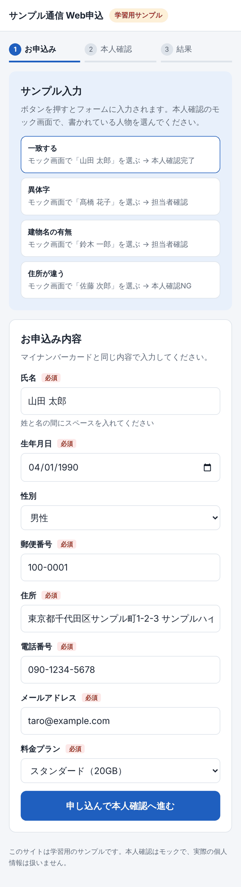
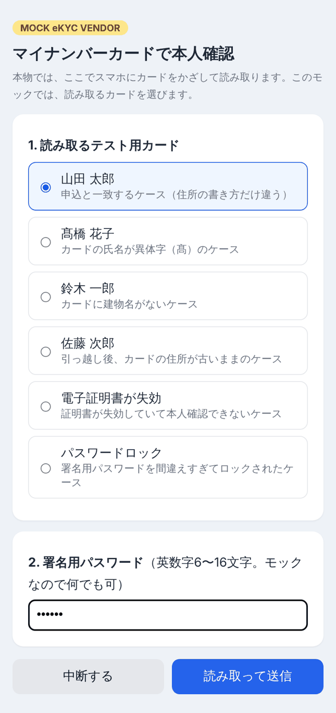
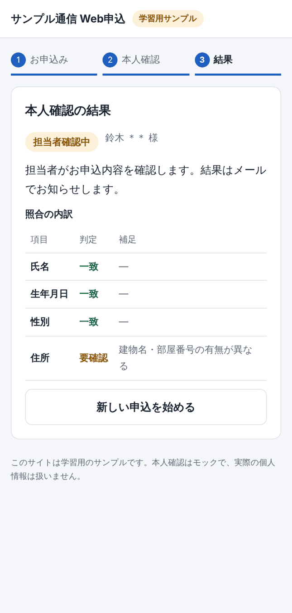

# eKYC 対応 Web 申込サンプル

携帯電話回線の Web 申込に、マイナンバーカードによる本人確認（eKYC）を組み込む改修を、小さく再現した学習用プロジェクトです。

- **frontend**: Vue 3 ＋ TypeScript（申込、本人確認、結果の3画面）
- **backend**: FastAPI（申込 API、本人確認 API、Webhook 受信、照合ロジック）
- **batch**: Python（kintone への同期）
- **モック**: eKYC ベンダーと kintone のモックを backend に同梱。外部サービスなしで最後まで動きます

| 申込 | モックベンダー | 結果 |
|---|---|---|
|  |  |  |

> 実在のサービスのコードではありません。よくある構成を想定して、学習用に作ったものです。

---

## 必要なもの

| ツール | バージョン |
|---|---|
| Python | 3.11 以上 |
| Node.js | 22.12 以上 |

---

## 起動方法

ターミナルを2つ使います。

### 1. backend

```bash
cd backend
python -m venv .venv
source .venv/bin/activate          # Windows は .venv\Scripts\activate
pip install -r requirements-dev.txt
cp .env.example .env               # Windows は copy .env.example .env
uvicorn app.main:app --reload --port 8000
```

`http://localhost:8000/docs` で API の一覧が見られます。

### 2. frontend

```bash
cd frontend
npm install
npm run dev
```

`http://localhost:5173` を開きます。

### 3. 試してみる

1. 申込画面の「サンプル入力」から1つ選び、申し込む
2. 「本人確認を始める」を押す
3. モック画面で、サンプル入力に書かれている人物のカードを選び、パスワード（英数字6文字以上なら何でも可）を入れて送信する
4. 結果画面で判定と内訳を見る

| サンプル入力 | 選ぶカード | 結果 |
|---|---|---|
| 一致する | 山田 太郎 | 本人確認完了 |
| 異体字 | 髙橋 花子 | 担当者確認中（氏名が要確認） |
| 建物名の有無 | 鈴木 一郎 | 担当者確認中（住所が要確認） |
| 住所が違う | 佐藤 次郎 | 本人確認NG |
| どれでも | パスワードロック／電子証明書が失効 | 本人確認エラー（再試行できる） |

### 4. kintone への同期

```bash
cd backend
python -m batch.sync_to_kintone --dry-run   # 対象件数の確認
python -m batch.sync_to_kintone             # 同期
```

`http://localhost:8000/mock-kintone/debug/records` で、モック kintone に登録された内容を確認できます。

---

## テスト

```bash
cd backend && pytest -v           # 45件
cd frontend && npm test           # 7件
cd frontend && npm run typecheck
```

---

## ディレクトリ構成

```
ekyc-sample/
├── backend/
│   ├── app/
│   │   ├── main.py               # アプリの組み立て
│   │   ├── config.py             # 設定（環境変数）
│   │   ├── models.py             # 入出力の型（Pydantic）
│   │   ├── routers/              # API（申込、eKYC）
│   │   ├── matching/             # 表記ゆれの正規化と照合
│   │   ├── security.py           # トークン、Webhook 署名
│   │   ├── masking.py            # 個人情報のマスキング
│   │   ├── repository.py         # DB アクセス
│   │   ├── services/             # ベンダー API クライアント
│   │   ├── mock_vendor/          # モック eKYC ベンダー
│   │   └── mock_kintone/         # モック kintone
│   ├── batch/                    # kintone 同期バッチ
│   └── tests/
├── frontend/
│   └── src/
│       ├── pages/                # 申込、本人確認、結果
│       ├── components/
│       ├── stores/               # Pinia
│       ├── composables/          # usePolling
│       └── api/
└── docs/
    ├── design/                   # 設計書
    └── catchup/                  # キャッチアップ資料
```

---

## ドキュメント

[docs/README.md](docs/README.md) に一覧があります。最初は [学習ロードマップ](docs/catchup/00_学習ロードマップ.md) から読むのがおすすめです。

---

## 設定で挙動を変える

`backend/.env` で変更できます（変更後はサーバーを再起動）。

| 変数 | 効果 |
|---|---|
| `MOCK_VENDOR_DUPLICATE_CALLBACK=true` | モックベンダーがコールバックを2回送る。重複が無視されることを確認できる |
| `MOCK_KINTONE_FAIL_FIRST_N=2` | モック kintone が最初の2回の書き込みを 503 で失敗させる。バッチのリトライを確認できる |
| `HANDOFF_TOKEN_TTL_SECONDS=60` | 受け渡しトークンの有効期限を短くし、期限切れの画面を確認できる |

データを消したいときは、サーバーを止めて `backend/data/` を削除します。モック kintone のデータはサーバーの再起動で消えます。
