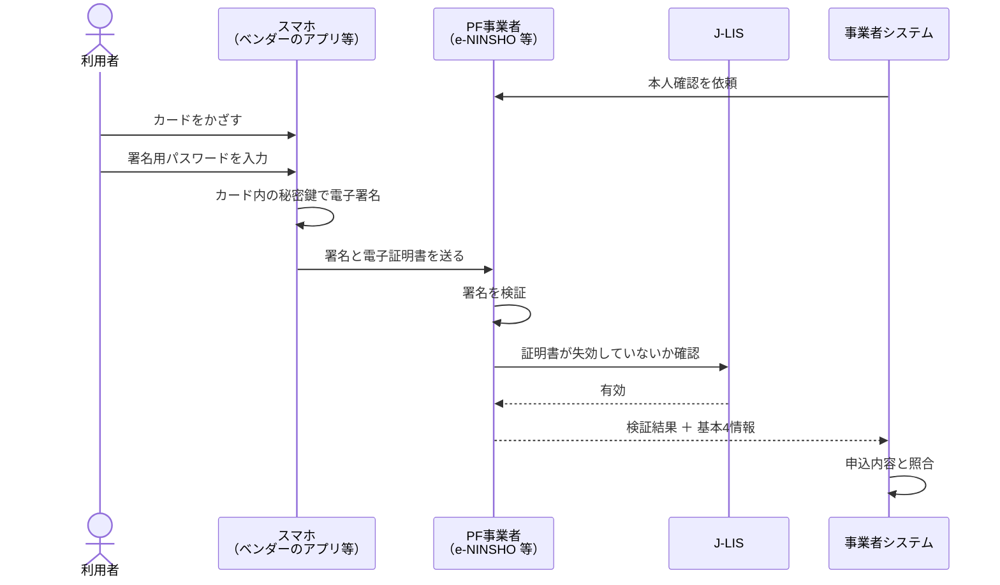

# eKYC と JPKI の基礎

> 2026年10月時点の公開情報をもとにまとめています。法令の細部は、必ず総務省の一次資料で確認してください。

---

## 1. なぜ今 eKYC 改修なのか

携帯電話の契約には、携帯電話不正利用防止法による本人確認が必要です。精巧に偽造された本人確認書類で契約された携帯電話が特殊詐欺に使われていることを受け、本人確認が段階的に厳しくなっています。

| 時期 | 出来事 |
|---|---|
| 2023年6月 | 政府の重点計画で、非対面の本人確認はマイナンバーカードの公的個人認証に原則一本化し、免許証などの画像送信は廃止する方針が示される |
| 2025年1〜2月 | 非対面の本人確認を見直す省令案の意見募集 |
| **2026年4月1日** | **非対面の改正が施行。** 本人確認書類の画像を送る方式（従来型 eKYC）が使えなくなる |
| 2026年7月27日 | 対面の改正省令が公布 |
| **2027年4月1日** | **対面の改正が施行。** 店頭でも IC チップの読み取りが原則に。新規契約だけでなく、名義変更や契約者確認なども対象。経過措置なし |

大手各社は 2026年1〜3月に、画像アップロード型をやめて IC チップを読み取る方式に切り替えています。

---

## 2. 非対面の本人確認方式

| 方式 | 中身 | 2026年4月以降 |
|---|---|---|
| 書類画像のアップロード／画像＋自撮り（従来型 eKYC） | 免許証などを撮影して送る | **廃止** |
| JPKI（公的個人認証） | カードの電子証明書で電子署名し、その署名を検証する | 利用可 |
| IC チップ読み取り＋容貌画像 | IC チップの情報を読み、その場で撮影した顔と照合する | 利用可 |

金融業界（犯罪収益移転防止法）では、JPKI を「ワ方式」、IC チップ＋容貌画像を「ヘ方式」、書類画像＋容貌画像を「ホ方式」と呼ぶことがあります。条項に由来する通称なので、法律ごとに番号が異なる点に注意します。

---

## 3. JPKI の仕組み

### 3.1 マイナンバーカードの電子証明書と暗証番号

| 種類 | 用途 | 中身 | 暗証番号 |
|---|---|---|---|
| **署名用電子証明書** | 身元確認（契約、口座開設） | **基本4情報**（氏名・住所・生年月日・性別） | 英数字 6〜16 文字 |
| 利用者証明用電子証明書 | ログイン（本人が操作していることの確認） | 基本4情報は含まない | 数字 4 桁 |
| 券面事項入力補助 | 券面の情報の読み出し | 券面情報（個人番号を含む） | 数字 4 桁 |

eKYC で使うのは **署名用電子証明書** です。利用者に「数字 4 桁ではなく、英数字のパスワードです」と案内するのが重要です。

### 3.2 PF 事業者（プラットフォーム事業者）

民間事業者が自分で J-LIS に接続するのではなく、総務大臣の認定を受けた事業者のサービスを使うのが一般的です。NRI の e-NINSHO はその一つで、2017年2月に認定を受け、金融機関の口座開設などで使われています。署名の検証のほか、J-LIS の失効情報をもとに、顧客の基本4情報の変更や死亡・海外転出を検知する機能もあります。

### 3.3 スマホ用電子証明書

電子証明書をスマホに搭載し、カードを持ち歩かなくても使える仕組みです。Android に加え iPhone でも使えます。ベンダーが対応しているか、対応範囲に含めるかを確認します。

---

## 4. 本人確認が失敗する主なケース

| ケース | 原因 | 案内 |
|---|---|---|
| パスワードロック | 署名用パスワードを一定回数間違えた | 市区町村の窓口で再設定 |
| 証明書の失効 | 引っ越しなどで住所が変わると、署名用電子証明書は失効する | 市区町村の窓口で再発行 |
| 証明書の有効期限切れ | 有効期限を過ぎた | 市区町村の窓口で更新 |
| 読み取り失敗 | NFC の位置、カードケース、非対応端末 | かざし方の案内、別の端末 |
| カードを持っていない | − | 別の手続き（店頭など）の案内 |
| 住所の不一致 | カードの住所を変更していない | 申込内容の修正、カードの住所変更 |

失敗の多くは利用者側で直せるので、**理由ごとに次の行動を案内する** ことが離脱を減らします（サンプルの `FAILURE_TEXT`）。

---

## 5. 法令・個人情報で注意すること

| 項目 | 内容 |
|---|---|
| 対象事業者 | 携帯音声通信事業者（MVNO を含む）、契約代理業者など |
| 本人確認記録 | 作成し、契約中と契約終了後3年間保存する |
| 個人番号（マイナンバー） | 番号法で、法令で定められた場合以外の収集・保管が禁止されている。署名用電子証明書には個人番号は含まれないが、券面情報を扱う方式では注意が必要 |
| 個人情報の最小化 | 必要な項目だけを取得し、連携先にも必要な分だけ渡す |

---

## 用語

| 用語 | 意味 |
|---|---|
| eKYC | electronic Know Your Customer。オンラインで完結する本人確認 |
| JPKI | 公的個人認証サービス。マイナンバーカードの電子証明書を使う本人確認の仕組み |
| 基本4情報 | 氏名、住所、生年月日、性別 |
| J-LIS | 地方公共団体情報システム機構。電子証明書の発行と失効情報の提供を行う |
| PF 事業者 | 総務大臣の認定を受け、署名検証などを提供する事業者 |
| 容貌画像 | 本人確認の場で撮影した本人の顔の画像 |
| 非対面／対面 | Web・郵送で完結する手続き／店頭で向き合う手続き |
| MVNO | 自社で回線設備を持たない通信事業者 |
| 犯収法 | 犯罪収益移転防止法。金融機関などの本人確認を定める |
| 番号法 | マイナンバー法。個人番号の扱いを定める |

---

## 参考資料

- 総務省: [非対面の本人確認に関する省令案の意見募集](https://www.soumu.go.jp/menu_news/s-news/01kiban18_01000244.html)
- 総務省: [対面の本人確認に関する省令案の意見募集](https://www.soumu.go.jp/menu_news/s-news/01kiban18_01000276.html)
- 消費者委員会 総務省説明資料: [携帯電話不正利用防止法の概要](https://www.cao.go.jp/consumer/iinkai/2023/406/doc/20230629_shiryou1-3_1.pdf)
- 三宅法律事務所: [2027年4月から変わる携帯電話契約の本人確認](https://www.miyake.gr.jp/wp-content/uploads/2026/07/AMLCFTセミナー_2027年4月から変わる携帯電話契約の本人確認.pdf)
- ソフトバンク: [省令改正に伴う非対面契約時の本人確認方法変更](https://www.softbank.jp/biz/news/other/20260101/)
- NRI: [e-NINSHO サービス概要](https://www.nri.com/jp/service/solution/eninsho.html)
- デジタル庁: [スマホ用電子証明書](https://www.digital.go.jp/policies/mynumber/smartphone-certification)
