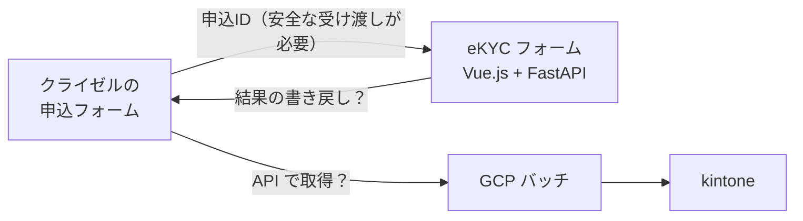

# クライゼルと GCP の基礎

このサンプルでは代用品で済ませている部分について、本番の構成で組み合わせることが多い製品の要点をまとめます。

---

## 1. クライゼル

### 1.1 どんな製品か

トライコーン株式会社のクラウド型 CRM です。次の機能をまとめて提供しています。

| 機能 | 内容 |
|---|---|
| Web フォーム | ノーコードで作成。HTML・CSS でのカスタマイズも可 |
| 顧客管理 | フォームで受け付けたデータをデータベースとして管理 |
| 会員サイト | ログイン付きのページ |
| メール配信 | 申込者への自動返信など |
| 外部連携 | REST API、Webhook、kintone 連携 |

### 1.2 kintone との連携

2025年3月に、kintone と連携するためのツール（「kreisel Webhookクリエイター for kintone」と、kintone プラグインの「kreiselコネクター」）が公開されています。kreiselコネクターは、クライゼルの API オプションと組み合わせて使います。

標準の連携ツールを使う方法のほかに、このサンプルのように GCP 上の自前のバッチで連携する方法もあります。既存のシステムを引き継ぐときは、どちらの方法なのか、なぜそうしているのかを確認します。

### 1.3 組み合わせる構成の例

既存のシステムを引き継ぐときに確認したいこと:

- 申込データの正はクライゼルか、自前の DB か
- クライゼルから eKYC フォームへ、申込IDをどう渡しているか（URL パラメータなら、改ざん対策はあるか）
- eKYC の結果をクライゼルに書き戻しているか
- API オプションや Webhook を契約しているか
- 改修でクライゼル側に手を入れられる範囲（画面のカスタマイズ、項目追加）

---

## 2. GCP

### 2.1 この構成で使うことが多いサービス

| サービス | 用途 | このサンプルでの相当物 |
|---|---|---|
| Cloud Run（サービス） | FastAPI を常時動かす | `uvicorn app.main:app` |
| Cloud Run Jobs | バッチを実行して終わる | `python -m batch.sync_to_kintone` |
| Cloud Scheduler | 定期的にジョブを起動する | 手動実行 |
| Secret Manager | API キーやトークンの保管 | `.env` |
| Cloud Logging | ログの集約・検索 | 標準出力 |
| Cloud Monitoring | ジョブ失敗の検知、アラート | バッチの終了コード |
| Cloud SQL | RDB | SQLite |

実際の構成はプロジェクトによって異なり、Cloud Functions や Compute Engine の場合もあります。

### 2.2 バッチを Cloud Run Jobs で動かすときの流れ

1. バッチをコンテナイメージにする（Dockerfile）
2. Cloud Run Jobs としてデプロイし、環境変数とシークレットを設定する
3. Cloud Scheduler で、5分ごとなどにジョブを起動する
4. ジョブが失敗（終了コード 1）したら、Cloud Monitoring でアラートを出す

このサンプルのバッチが「失敗したら終了コード 1 を返す」「何度実行しても二重登録しない」作りになっているのは、この運用を想定しているためです。

### 2.3 権限の考え方

- ジョブやサービスには専用のサービスアカウントを付け、必要な権限だけを与える
- 秘密情報はコードやイメージに含めず、Secret Manager から環境変数として渡す
- ログに個人情報を出さない（Cloud Logging は多くの人が閲覧できることが多い）

---

## 3. 引き継ぎ時の確認リスト

- [ ] GCP プロジェクトの構成（開発・検証・本番が分かれているか）
- [ ] バッチの実行基盤と実行間隔
- [ ] デプロイ方法（手動、CI/CD）
- [ ] ログとアラートの見方、失敗時の連絡先
- [ ] 自分に付与される権限
- [ ] クライゼルの管理画面のアカウント、触ってよい範囲
- [ ] クライゼルと kintone の契約内容（API オプション、kintone のコース）

---

## 参考

- 比較ビズ: [クライゼルとは](https://saas.imitsu.jp/cate-crm/service/3607)
- [クライゼルと kintone の相互連携ツールのリリース記事](https://xexeq.jp/blogs/media/topics42715)
- Google Cloud: [Cloud Run のドキュメント](https://cloud.google.com/run/docs)
