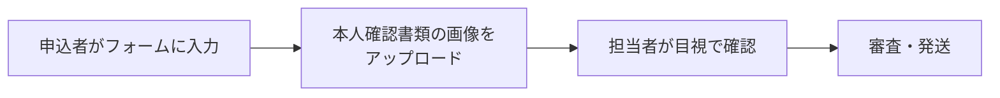
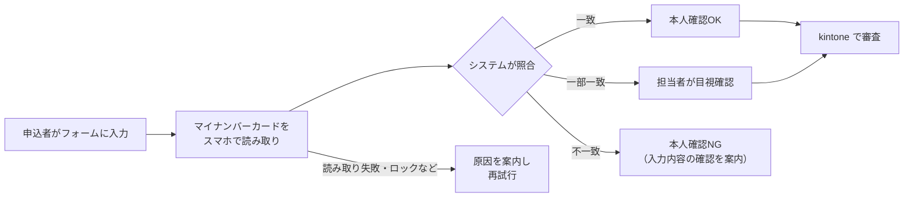

# 要件定義書

| 版 | 日付 | 内容 |
|---|---|---|
| 0.1 | 2026-10-28 | 初版（サンプルプロジェクト用） |

> このサンプルは、通信サービスの Web 申込に eKYC を組み込む改修を想定し、小さく再現したものです。実在のサービスの要件ではありません。本番化に向けて決める必要がある論点は「8. 未決事項」にまとめています。

---

## 1. 背景と目的

### 1.1 背景

携帯電話の契約時の本人確認は、携帯電話不正利用防止法で義務付けられています。偽造された本人確認書類による不正契約が特殊詐欺に使われていることを受け、非対面（Web）の本人確認が厳格化されました。

| 時期 | 内容 |
|---|---|
| 2026年4月1日 施行 | 非対面: 本人確認書類の画像を送る方式（従来型eKYC）を廃止。JPKI（公的個人認証）や、ICチップ読み取り＋容貌画像の方式に移行 |
| 2027年4月1日 施行 | 対面: ICチップの読み取りが原則に。名義変更や契約者確認なども対象 |

詳しくは [キャッチアップ資料: eKYCとJPKIの基礎](../catchup/03_eKYCとJPKIの基礎.md) を参照。

### 1.2 目的

Web申込の流れに、マイナンバーカードによる本人確認（JPKI）を組み込む。

- 申込内容と、カードから取得した基本4情報（氏名・住所・生年月日・性別）を照合し、本人確認の可否を判定する
- 判定結果を、審査担当が使う業務システム（kintone）に連携する
- 申込者が途中で失敗しても、自分で原因を理解してやり直せるようにする

---

## 2. スコープ

| 区分 | 対象 | このサンプルでの扱い |
|---|---|---|
| 申込受付 | 申込フォーム | 本番はフォーム SaaS（クライゼルなど）を想定。サンプルは Vue＋FastAPI で代用 |
| 本人確認 | eKYC 画面、本人確認 API | Vue＋FastAPI で実装 |
| 外部連携 | eKYC ベンダー（PF事業者） | モックで代用（`/mock-vendor`） |
| 業務連携 | kintone への同期バッチ | Python バッチ＋モック kintone（`/mock-kintone`） |
| 対象外 | 審査、SIM発送、開通、決済、店頭（対面）手続き、法人申込 | 扱わない |

---

## 3. 用語

主な用語は [キャッチアップ資料](../catchup/03_eKYCとJPKIの基礎.md#用語) にまとめています。

---

## 4. 業務フロー

### 4.1 改修前（想定）

### 4.2 改修後

---

## 5. 機能要件

| ID | 機能 | 内容 | 実装 |
|---|---|---|---|
| F-01 | 申込受付 | 氏名、生年月日、性別（任意）、郵便番号、住所、電話番号、メール、プランを受け付ける。18歳以上に限る | `POST /api/applications` |
| F-02 | 申込IDの受け渡し | 申込フォームから eKYC 画面へ、改ざんできない形で申込IDを渡す | 署名付きトークン（`app/security.py`） |
| F-03 | 本人確認の開始 | ベンダーにセッションを作らせ、ベンダーの画面へ誘導する | `POST /api/ekyc/sessions` |
| F-04 | 結果の受信 | ベンダーから結果をコールバックで受け取る。偽装・重複を防ぐ | `POST /api/ekyc/callback` |
| F-05 | 照合 | 申込内容と基本4情報を照合し、OK／要確認／NG を判定する | `app/matching/` |
| F-06 | 結果表示 | 申込者に結果と、次にすべきことを表示する。個人情報は最小限 | `GET /api/applications/{id}`、結果画面 |
| F-07 | 再試行 | ロック、失効、中断などで失敗した場合、本人確認をやり直せる | 状態 `EKYC_FAILED` から再開可 |
| F-08 | kintone 連携 | 結果が出た申込を kintone に登録・更新する | `batch/sync_to_kintone.py` |
| F-09 | 例外の案内 | PC からのアクセス、パスワードロック、証明書失効などを案内する | 本人確認画面、結果画面 |

---

## 6. 非機能要件

| 区分 | 要件 | このサンプルでの扱い |
|---|---|---|
| 性能 | 申込から結果表示まで、ベンダー側の処理を除き数秒以内 | ポーリング間隔 1.5 秒 |
| 可用性 | ベンダーや kintone が一時的に落ちても、データを失わない | 外部呼び出しのリトライ、未連携データの再送 |
| セキュリティ | なりすまし、改ざん、他人の申込の閲覧を防ぐ | [セキュリティ設計書](06_セキュリティ設計書.md) |
| 個人情報 | 取得は最小限。ログには出さない。連携先には必要な項目だけ渡す | マスキング、kintone へはカード情報を送らない |
| 法令 | 本人確認記録を作成し、契約中と契約終了後3年間保存する | DB に保存（削除処理は未実装。演習課題） |
| 運用 | 障害を検知でき、再実行で復旧できる | バッチは失敗時に終了コード1、再実行で二重登録しない |
| 制限値 | kintone の API 制限内に収める | 100件ずつ分割、対象がなければ API を呼ばない |

---

## 7. 前提・制約

- eKYC ベンダーとの詳細仕様（API、コールバック形式）はベンダーごとに異なる。サンプルの形式は学習用の仮のもの
- Web ブラウザだけではマイナンバーカードの IC チップを読めないため、実際はベンダーのアプリや SDK を経由する
- kintone のフィールド構成は審査業務に合わせて決める。サンプルは一例

---

## 8. 未決事項（本番化に向けて決めること）

本番化の要件定義で、最初に詰めるべき論点です。決定者と期限を付けて管理します。

| No | 論点 | 選択肢の例 | 決める人（想定） |
|---|---|---|---|
| 1 | 本人確認の方式 | JPKI のみ／ICチップ＋容貌画像も併用 | PM、法務 |
| 2 | eKYC ベンダー | e-NINSHO など。API 仕様、費用、スマホ用電子証明書への対応 | PM |
| 3 | 照合ルール | 表記ゆれをどこまで同一とみなすか、異体字の扱い | 審査、法務 |
| 4 | 照合NG時の扱い | 再入力を許すか、別の手続きへ案内するか | 審査、CS |
| 5 | マイナンバーカードがない人 | 店頭での手続きへ案内するなど | 事業側 |
| 6 | PC からの申込 | QR コードでスマホへ引き継ぐか、スマホのみに限るか | 事業側、UX |
| 7 | 対象の手続き | 新規、MNP、名義変更、法人申込 | PM |
| 8 | 本人確認記録の保存 | 保存先、暗号化、契約終了後3年での削除方法 | 法務、情シス |
| 9 | kintone の項目と権限 | 審査担当が見る項目、閲覧できる人 | 審査、情シス |
| 10 | リリース時期 | 法令施行日、事業計画との関係 | PM |
