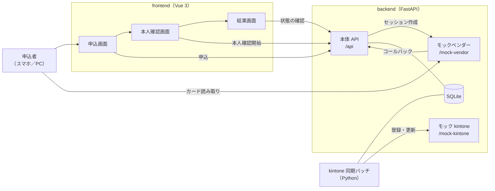
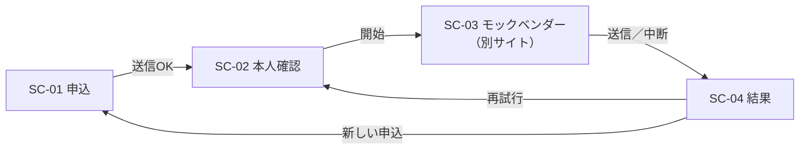
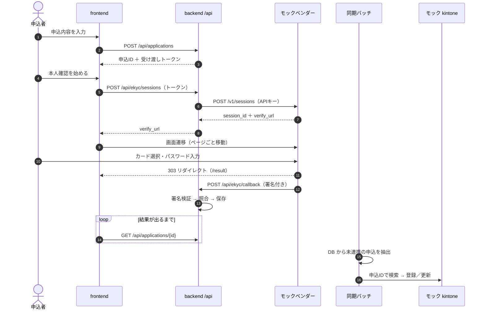
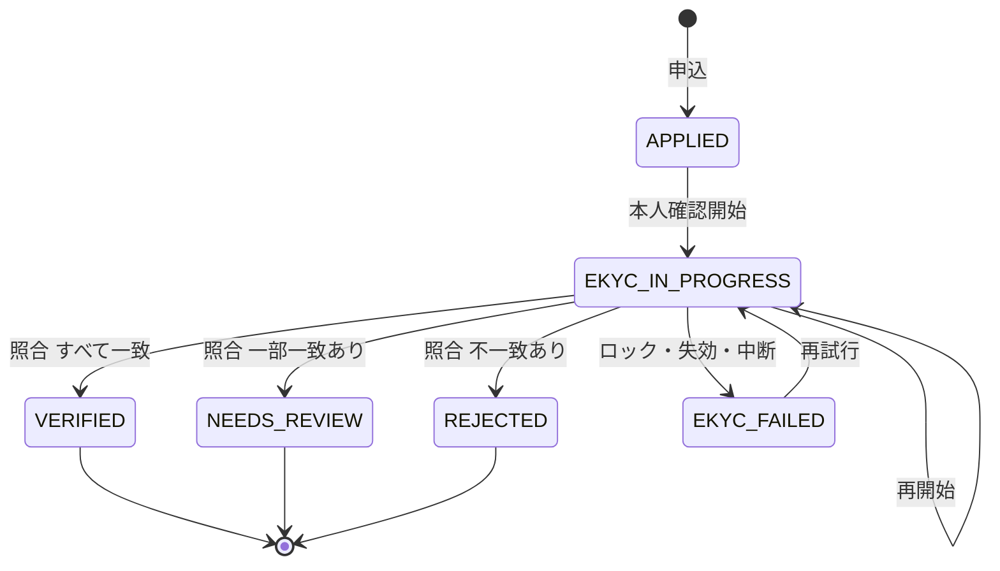

# 基本設計書

| 版 | 日付 | 内容 |
|---|---|---|
| 0.1 | 2026-10-28 | 初版 |

---

## 1. システム構成

### 1.1 本番構成との対応（例）

| サンプル | 本番の構成例 | 備考 |
|---|---|---|
| 申込画面（Vue） | フォーム SaaS（クライゼルなど）の申込フォーム | ノーコード。項目追加や遷移の変更が改修対象 |
| 本人確認画面・結果画面（Vue） | eKYC フォーム（Vue.js） | 自前開発 |
| 本体 API（FastAPI） | eKYC フォームのバックエンド（FastAPI） | 自前開発 |
| SQLite | フォーム SaaS 側の DB、または自前の DB | 構成によって異なる |
| モックベンダー | e-NINSHO などの PF 事業者 | 実際はアプリ／SDK で IC チップを読む |
| モック kintone | kintone | 審査担当が使う |
| 同期バッチ | GCP 上の Python バッチ | Cloud Run Jobs ＋ Cloud Scheduler など |

---

## 2. コンポーネント一覧

| 場所 | 役割 |
|---|---|
| `frontend/src/pages/` | 画面（申込、本人確認、結果） |
| `frontend/src/components/` | 部品（入力欄、状態バッジ） |
| `frontend/src/stores/application.ts` | 申込IDとトークンの保持（Pinia） |
| `frontend/src/composables/usePolling.ts` | 結果のポーリング |
| `frontend/src/api/client.ts` | API 呼び出しとエラー整形 |
| `backend/app/routers/` | API のエンドポイント |
| `backend/app/matching/` | 表記ゆれの正規化と照合 |
| `backend/app/security.py` | トークンと Webhook 署名 |
| `backend/app/masking.py` | 個人情報のマスキング |
| `backend/app/repository.py` | DB アクセス |
| `backend/app/services/ekyc_vendor.py` | ベンダー API クライアント |
| `backend/batch/` | kintone 同期バッチ |

---

## 3. 画面一覧と画面遷移

| ID | 画面 | URL | 主な内容 |
|---|---|---|---|
| SC-01 | 申込 | `/` | 申込内容の入力、サンプル入力 |
| SC-02 | 本人確認 | `/ekyc` | 用意するものの案内、本人確認の開始 |
| SC-03 | モックベンダー | `http://localhost:8000/mock-vendor/verify/{id}` | テスト用カードの選択、パスワード入力 |
| SC-04 | 結果 | `/result` | 判定結果、照合の内訳、再試行 |

申込前に SC-02、SC-04 を直接開いた場合は SC-01 に戻す（`router.ts` のナビゲーションガード）。

---

## 4. 処理フロー

コールバック（12）は画面のリダイレクト（11）と非同期に届くため、結果画面は状態が確定するまでポーリングする。

---

## 5. 外部インターフェース一覧

| ID | 相手 | 方向 | 方式 | 詳細 |
|---|---|---|---|---|
| IF-01 | eKYC ベンダー | 送信 | REST（APIキー認証） | セッション作成 |
| IF-02 | eKYC ベンダー | 受信 | Webhook（HMAC 署名） | 本人確認結果 |
| IF-03 | kintone | 送信 | REST（APIトークン認証） | レコードの検索・登録・更新 |

詳細は [API設計書](03_API設計書.md) と [バッチ設計書](07_バッチ設計書.md)。

---

## 6. 申込の状態遷移

| 状態 | 画面表示 | 再試行 | kintone 連携 |
|---|---|---|---|
| APPLIED | 申込受付 | 可 | しない |
| EKYC_IN_PROGRESS | 本人確認中 | 可 | しない |
| VERIFIED | 本人確認完了 | 不可 | する |
| NEEDS_REVIEW | 担当者確認中 | 不可 | する |
| REJECTED | 本人確認NG | 不可 | する |
| EKYC_FAILED | 本人確認エラー（理由別の案内） | 可 | する |

---

## 7. エラー処理の方針

| 種類 | 例 | 対応 |
|---|---|---|
| 入力エラー | 必須漏れ、18歳未満 | 画面で即時に表示。サーバーでも 422 で弾く |
| 認証エラー | トークン期限切れ | 401。画面で「最初からやり直す」を表示 |
| 状態エラー | 本人確認済みの申込で再開始 | 409。結果画面へ移動 |
| 外部の一時障害 | ベンダーや kintone の 5xx、通信エラー | 指数バックオフで最大3回リトライ。だめなら 502 またはバッチ失敗 |
| 外部の恒久エラー | 4xx | リトライしない。ログに残して失敗扱い |
| 重複 | コールバックの再送 | 200 で受け、処理はしない |

---

## 8. ログの方針

- 出してよいもの: 申込ID、セッションID、状態、件数、エラーの種類
- 出さないもの: 氏名、住所、電話番号、メール、生年月日、カードの読み取り値
- 識別が必要な場合だけ、マスクした値を出す（例: `山田 ＊＊`）

詳細は [セキュリティ設計書](06_セキュリティ設計書.md#4-ログ出力のルール)。
