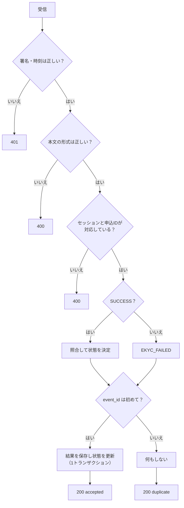

# API設計書

| 版 | 日付 | 内容 |
|---|---|---|
| 0.1 | 2026-10-28 | 初版 |

サーバー起動中は `http://localhost:8000/docs` で、FastAPI が自動生成した仕様（Swagger UI）も確認できます。この設計書は、自動生成では伝わらない「なぜそうしたか」を補うものです。

---

## 1. 共通仕様

| 項目 | 内容 |
|---|---|
| ベースURL | `http://localhost:8000`（開発時は Vite のプロキシ経由で `/api` を呼ぶ） |
| 形式 | JSON（UTF-8） |
| 認証 | 申込者向け API は受け渡しトークン（`Authorization: Bearer <token>`） |
| 時刻 | ISO 8601、UTC |

### 1.1 エラー応答

FastAPI 標準の形式です。

```json
{ "detail": "トークンが無効です" }
```

入力チェックのエラー（422）は配列になります。

```json
{ "detail": [ { "loc": ["body", "birth_date"], "msg": "Value error, 18歳以上の方のみお申込みいただけます", "type": "value_error" } ] }
```

| ステータス | 意味 |
|---|---|
| 400 | 形式は正しいが内容が不正（未知のセッションなど） |
| 401 | トークン・署名が不正、または期限切れ |
| 404 | 申込が見つからない（他人の申込を見ようとした場合も含む） |
| 409 | 状態的に実行できない（本人確認済みなど） |
| 422 | 入力チェックのエラー |
| 502 | ベンダーに接続できない |

---

## 2. エンドポイント一覧

| ID | メソッド | パス | 認証 | 用途 |
|---|---|---|---|---|
| API-01 | POST | `/api/applications` | なし | 申込を登録 |
| API-02 | GET | `/api/applications/{application_id}` | トークン | 申込の状態を取得 |
| API-03 | POST | `/api/ekyc/sessions` | トークン（本文） | 本人確認を開始 |
| API-04 | POST | `/api/ekyc/callback` | Webhook 署名 | 本人確認結果を受信 |
| API-05 | GET | `/api/healthz` | なし | 死活監視 |

---

## 3. API-01 申込を登録

`POST /api/applications`

### リクエスト

| 項目 | 型 | 必須 | 制約 |
|---|---|---|---|
| name | string | ○ | 1〜50文字。姓と名の間にスペース（画面側でチェック） |
| birth_date | string（date） | ○ | 18歳以上 |
| gender | `"male"` / `"female"` / null | | 未回答は null |
| postal_code | string | ○ | `123-4567` または `1234567` |
| address | string | ○ | 1〜200文字 |
| phone | string | ○ | 0 から始まる電話番号 |
| email | string | ○ | メール形式 |
| plan | `"light"` / `"standard"` / `"unlimited"` | ○ | |

```json
{
  "name": "山田 太郎",
  "birth_date": "1990-04-01",
  "gender": "male",
  "postal_code": "100-0001",
  "address": "東京都千代田区サンプル町1-2-3 サンプルハイツ101",
  "phone": "090-1234-5678",
  "email": "taro@example.com",
  "plan": "standard"
}
```

### レスポンス（201）

```json
{
  "application_id": "a825f93e-3d82-4f56-a7c9-2d28f1c5df42",
  "handoff_token": "eyJhaWQiOi....Qk3x...",
  "expires_at": "2026-10-28T09:20:57Z"
}
```

`handoff_token` は「申込ID＋有効期限（30分）」に HMAC-SHA256 で署名したもの。既存の申込フォーム（フォーム SaaS など）から eKYC 画面へ申込IDを渡す構成でも、同じ考え方が必要になる。

---

## 4. API-02 申込の状態を取得

`GET /api/applications/{application_id}`　ヘッダー `Authorization: Bearer <handoff_token>`

トークンの申込IDとパスの申込IDが違う場合は **404**（403 にしないのは、他人の申込が存在するかどうかも教えないため）。

### レスポンス（200）

```json
{
  "application_id": "a825f93e-...",
  "status": "NEEDS_REVIEW",
  "status_label": "担当者確認中",
  "message": "担当者がお申込内容を確認します。結果はメールでお知らせします。",
  "masked_name": "鈴木 ＊＊",
  "can_retry": false,
  "match_items": [
    { "field": "name", "label": "氏名", "result": "MATCH", "note": "" },
    { "field": "address", "label": "住所", "result": "PARTIAL", "note": "建物名・部屋番号の有無が異なる" }
  ],
  "updated_at": "2026-10-28T08:50:59.123456Z"
}
```

申込者向けの応答には、住所やカードの読み取り値を含めない。照合の内訳も「項目名と判定」だけにする。

---

## 5. API-03 本人確認を開始

`POST /api/ekyc/sessions`

```json
{ "handoff_token": "..." }
```

### 処理

1. トークンを検証（不正・期限切れは 401）
2. 申込の状態が `APPLIED`、`EKYC_IN_PROGRESS`、`EKYC_FAILED` のいずれかか確認（それ以外は 409）
3. ベンダーにセッション作成を依頼（IF-01）。一時障害は最大3回リトライ、だめなら 502
4. セッションを保存し、状態を `EKYC_IN_PROGRESS` に

### レスポンス（200）

```json
{ "verify_url": "http://localhost:8000/mock-vendor/verify/ses_6f1c..." }
```

フロントはこの URL へページごと移動する。

---

## 6. API-04 本人確認結果を受信（Webhook）

`POST /api/ekyc/callback`（ベンダーから呼ばれる）

### ヘッダー

| ヘッダー | 内容 |
|---|---|
| `X-Vendor-Timestamp` | 送信時刻（UNIX秒） |
| `X-Vendor-Signature` | `sha256=` ＋ HMAC-SHA256(シークレット, `"{timestamp}." + 本文`) の16進 |

### 本文

```json
{
  "event_id": "evt_0b5c...",
  "session_id": "ses_6f1c...",
  "reference_id": "a825f93e-...",
  "result": "SUCCESS",
  "failure_reason": null,
  "identity": {
    "name": "山田 太郎",
    "birth_date": "1990-04-01",
    "gender": "male",
    "address": "東京都千代田区サンプル町一丁目2番3号サンプルハイツ101号室"
  },
  "verified_at": "2026-10-28T08:50:58.000000+00:00"
}
```

`result` が `FAILED` のときは `identity` が null で、`failure_reason` に `PIN_LOCKED`、`CERT_REVOKED`、`CERT_EXPIRED`、`CANCELLED` などが入る。

### 処理



### 設計上のポイント

- **署名は生の本文で検証する。** JSON として読み直すと、キーの順序や空白が変わり署名が一致しなくなる
- **タイムスタンプも署名に含め、5分以上ずれたものは拒否する。** 盗まれた通信の再送（リプレイ）を防ぐ
- **重複には 200 を返す。** エラーを返すと、ベンダーは失敗とみなして再送し続ける
- **結果の保存と状態の更新を同じトランザクションにする。** 片方だけ反映された中途半端な状態を作らない

---

## 7. 外部 API（ベンダー）との取り決め

このサンプルのモックベンダーの仕様です。実際のベンダーの仕様は契約後に入手します。

### IF-01 セッション作成

`POST {VENDOR_BASE_URL}/v1/sessions`　ヘッダー `Authorization: Bearer <VENDOR_API_KEY>`

```json
{ "reference_id": "申込ID", "callback_url": "http://localhost:8000/api/ekyc/callback", "return_url": "http://localhost:5173/result" }
```

```json
{ "session_id": "ses_...", "verify_url": "http://localhost:8000/mock-vendor/verify/ses_..." }
```

### IF-02 コールバック

API-04 を参照。モックは失敗時に最大3回再送し、`MOCK_VENDOR_DUPLICATE_CALLBACK=true` のときは同じ内容を2回送る（冪等性の確認用）。

---

## 8. 本番化に向けて確認すること

- ベンダーのコールバック署名の方式（HMAC か、公開鍵署名か）とシークレットの受け渡し方法
- コールバックが届かない場合の救済（ベンダーへの結果照会 API があるか）
- セッションの有効期限と、期限切れ時の挙動
- 基本4情報の表記（住所の書き方、外字の扱い）
