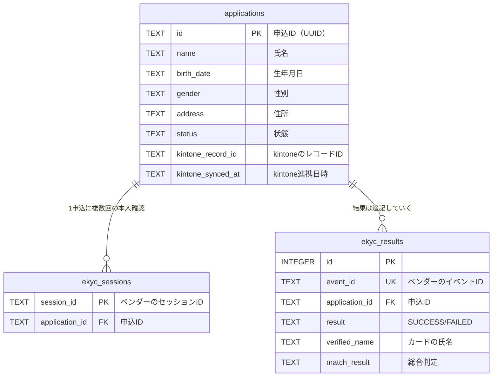

# データ設計書

| 版 | 日付 | 内容 |
|---|---|---|
| 0.1 | 2026-10-28 | 初版 |

DB はサンプルのため SQLite（`backend/data/ekyc_sample.db`）。スキーマは `backend/app/db.py` にあり、起動時に自動作成されます。

---

## 1. ER 図

（図は主な列のみ。全列は下の表を参照）

---

## 2. テーブル定義

個人情報区分: **A** = 本人確認記録（法定保存）、**B** = 申込の個人情報、**−** = 個人情報ではない

### 2.1 applications（申込）

| 列 | 型 | NULL | 区分 | 説明 |
|---|---|---|---|---|
| id | TEXT | × | − | 申込ID（UUID v4）。推測されにくい値にする |
| name | TEXT | × | B | 氏名 |
| birth_date | TEXT | × | B | 生年月日（YYYY-MM-DD） |
| gender | TEXT | ○ | B | `male` / `female`。未回答は NULL |
| postal_code | TEXT | × | B | 郵便番号 |
| address | TEXT | × | B | 住所 |
| phone | TEXT | × | B | 電話番号 |
| email | TEXT | × | B | メールアドレス |
| plan | TEXT | × | − | 料金プラン |
| status | TEXT | × | − | 状態（3章） |
| created_at | TEXT | × | − | 作成日時（UTC） |
| updated_at | TEXT | × | − | 更新日時（UTC）。状態が変わると更新 |
| kintone_record_id | TEXT | ○ | − | kintone 側のレコードID |
| kintone_synced_at | TEXT | ○ | − | 最後に kintone へ反映した日時 |

### 2.2 ekyc_sessions（本人確認セッション）

| 列 | 型 | NULL | 区分 | 説明 |
|---|---|---|---|---|
| session_id | TEXT | × | − | ベンダーが発行したセッションID |
| application_id | TEXT | × | − | 申込ID |
| created_at | TEXT | × | − | 作成日時 |

コールバックの `session_id` と `reference_id`（申込ID）の組み合わせが、ここに記録したものと一致するかを確認する。

### 2.3 ekyc_results（本人確認結果）

| 列 | 型 | NULL | 区分 | 説明 |
|---|---|---|---|---|
| id | INTEGER | × | − | 連番 |
| event_id | TEXT | × | − | ベンダーのイベントID。**UNIQUE**（重複受信の防止） |
| application_id | TEXT | × | − | 申込ID |
| session_id | TEXT | × | − | セッションID |
| result | TEXT | × | − | `SUCCESS` / `FAILED` |
| failure_reason | TEXT | ○ | − | 失敗理由（`PIN_LOCKED` など） |
| verified_name | TEXT | ○ | A | カードの氏名 |
| verified_birth_date | TEXT | ○ | A | カードの生年月日 |
| verified_gender | TEXT | ○ | A | カードの性別 |
| verified_address | TEXT | ○ | A | カードの住所 |
| match_result | TEXT | ○ | − | 総合判定（`VERIFIED` など） |
| match_detail | TEXT | ○ | − | 項目ごとの判定（JSON） |
| received_at | TEXT | × | − | 受信日時 |

結果は上書きせず追記する。再試行した場合は複数行になり、最新（id が最大）の行を使う。

---

## 3. コード値

### 3.1 申込の状態（applications.status）

| 値 | 意味 |
|---|---|
| APPLIED | 申込受付（本人確認前） |
| EKYC_IN_PROGRESS | 本人確認中 |
| VERIFIED | 本人確認OK |
| NEEDS_REVIEW | 担当者の目視確認が必要 |
| REJECTED | 照合NG |
| EKYC_FAILED | 本人確認そのものが失敗 |

### 3.2 失敗理由（ekyc_results.failure_reason）

| 値 | 意味 | 申込者への案内 |
|---|---|---|
| PIN_LOCKED | 署名用パスワードのロック | 市区町村の窓口で再設定 |
| CERT_REVOKED | 電子証明書の失効 | 市区町村の窓口で再発行 |
| CERT_EXPIRED | 電子証明書の有効期限切れ | 市区町村の窓口で更新 |
| CANCELLED | 利用者が中断 | もう一度試す |

---

## 4. 保存期間と削除

| データ | 保存期間 | このサンプル |
|---|---|---|
| 本人確認記録（区分A） | 契約中と、契約終了後3年間（携帯電話不正利用防止法） | 削除処理なし（演習課題） |
| 申込の個人情報（区分B） | 社内規程による | 削除処理なし |

本番では、暗号化（DB の暗号化、列単位の暗号化）、アクセスできる人の制限、監査ログもあわせて設計する。

---

## 5. kintone アプリのフィールド（想定）

| フィールドコード | 種類（想定） | 内容 | 備考 |
|---|---|---|---|
| 申込ID | 文字列（1行） | 申込ID | **値の重複を禁止する**。二重登録の防止に使う |
| 氏名 | 文字列（1行） | | |
| 生年月日 | 日付 | | |
| 住所 | 文字列（複数行） | | |
| 電話番号 | 文字列（1行） | | |
| メールアドレス | 文字列（1行） | | |
| プラン | ドロップダウン | | |
| 本人確認ステータス | ドロップダウン | 本人確認OK／要確認／照合NG／本人確認エラー | |
| 照合結果 | 文字列（複数行） | 「氏名: 一致 / 住所: 一部一致（…）」 | 審査担当が読むための要約 |
| エラー理由 | 文字列（1行） | `PIN_LOCKED` など | |
| 本人確認日時 | 文字列（1行） | | 本番では日時フィールドにして形式を合わせる |

カードの読み取り値（区分A）は kintone に送らない。審査に必要なのは「一致したかどうか」で、カードの値そのものではないため。
