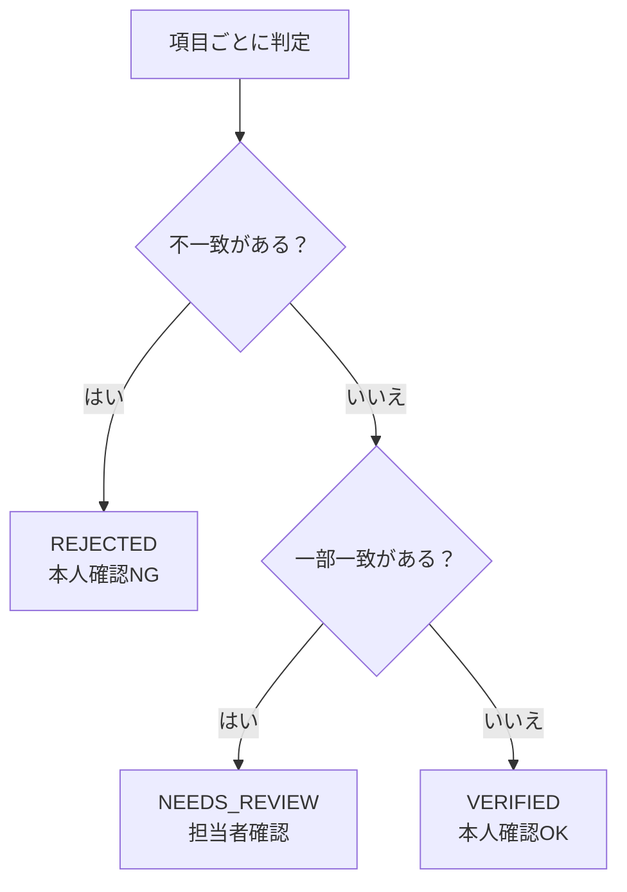

# 照合ロジック設計書

| 版 | 日付 | 内容 |
|---|---|---|
| 0.1 | 2026-10-28 | 初版 |

実装: `backend/app/matching/normalize.py`、`backend/app/matching/matcher.py`
テスト: `backend/tests/test_normalize.py`、`backend/tests/test_matcher.py`

> この設計書は、ビジネス側（審査、法務）と合意する場面を想定して書いています。ルールの中身は例であり、本番では合意した内容に置き換えます。

---

## 1. 目的

申込で入力された内容と、マイナンバーカードから取得した基本4情報が同じ人のものかを判定する。

人が入力する値とカードの値は、書き方が違うことがよくあります（「1-2-3」と「一丁目2番3号」など）。そのまま比べると、本人なのに NG になります。そこで次の2段階で判定します。

1. **正規化**: 書き方の違いをそろえる
2. **判定**: そろえた値を項目ごとに比べ、総合判定を出す

---

## 2. 正規化ルール

### 2.1 氏名

| No | ルール | 例 |
|---|---|---|
| N-1 | 全角・半角をそろえる（Unicode NFKC 正規化） | `ＡＢＣ` → `ABC` |
| N-2 | スペースをすべて取り除く | `山田　太郎` → `山田太郎` |
| N-3 | （判定時のみ）異体字を標準の字にそろえる | `髙橋` → `高橋` |

N-3 で初めて一致した場合は「一部一致」とし、人が確認する（2.3 参照）。

### 2.2 住所

| No | ルール | 例 |
|---|---|---|
| A-1 | 全角・半角をそろえ、スペースを取り除く | `１－２－３` → `1-2-3` |
| A-2 | 丁目・番地・番・号の前の漢数字を算用数字にする | `一丁目` → `1丁目`、`十二番` → `12番` |
| A-3 | 数字にはさまれたハイフン類（‐ − ー など）を `-` にそろえる | `1ー2ー3` → `1-2-3` |
| A-4 | 丁目・番地・番・号をハイフン区切りにする | `1丁目2番3号` → `1-2-3`、`1丁目2番地3` → `1-2-3` |
| A-5 | 部屋番号の「号室」を取る | `101号室` → `101` |

### 2.3 異体字の対応表（例）

| 異体字 | 標準 | 異体字 | 標準 |
|---|---|---|---|
| 髙 | 高 | 濱 | 浜 |
| 﨑、嵜 | 崎 | 櫻 | 桜 |
| 齋 | 斎 | 廣 | 広 |
| 齊 | 斉 | 國 | 国 |
| 邊、邉 | 辺 | 實 | 実 |
| 澤 | 沢 | 惠、眞、德 | 恵、真、徳 |

戸籍上「齋藤」と「斎藤」は別の氏です。だからこそ、異体字の違いだけで一致した場合も自動で OK にせず、人が確認します。

---

## 3. 項目ごとの判定

| 項目 | 一致（MATCH） | 一部一致（PARTIAL） | 不一致（MISMATCH） | 対象外（SKIPPED） |
|---|---|---|---|---|
| 氏名 | 正規化後に同じ | 異体字をそろえると同じ | それ以外 | − |
| 生年月日 | 同じ日付 | − | 違う日付 | − |
| 性別 | 同じ | − | 違う | 申込で未回答 |
| 住所 | 正規化後に同じ | 片方がもう片方の先頭と一致し、残りが建物名・部屋番号だけ | それ以外 | − |

### 3.1 住所の「一部一致」の注意

`1-2-3` と `1-2-35` は先頭が一致しますが、別の住所です。そこで、残りの部分が **数字やハイフンで始まる場合は一部一致にしない** ようにしています。

| 申込 | カード | 判定 |
|---|---|---|
| サンプル町1-2-3 サンプルハイツ101 | サンプル町一丁目2番3号サンプルハイツ101号室 | 一致 |
| 見本台4-5-6 ミライタワー2003 | 見本台四丁目5番6号 | 一部一致 |
| サンプル町1-2-3 | サンプル町1-2-35 | 不一致 |
| 新住所町1-1-1 | 旧住所町三丁目4番5号 | 不一致 |

---

## 4. 総合判定

| 条件 | 総合判定 | 申込の状態 | 申込者への表示 |
|---|---|---|---|
| どれか1つでも不一致 | NG | REJECTED | 入力内容の確認を案内 |
| 不一致はなく、一部一致がある | 要確認 | NEEDS_REVIEW | 担当者が確認する旨を案内 |
| すべて一致（または対象外） | OK | VERIFIED | 審査に進む旨を案内 |

---

## 5. テストケース

| No | ケース | 期待 | テスト |
|---|---|---|---|
| 1 | 全項目一致（住所の書き方だけ違う） | VERIFIED | `test_all_match_is_verified` |
| 2 | 氏名が異体字 | NEEDS_REVIEW | `test_itaiji_name_needs_review` |
| 3 | 氏名が違う | REJECTED | `test_different_name_is_rejected` |
| 4 | 生年月日が違う | REJECTED | `test_birth_date_mismatch_is_rejected` |
| 5 | 建物名の有無だけ違う | PARTIAL | `test_building_name_difference_is_partial` |
| 6 | 番地の途中まで一致 | MISMATCH | `test_address_number_prefix_is_not_partial` |
| 7 | 住所が違う（引っ越し） | REJECTED | `test_different_address_is_rejected` |
| 8 | 性別が未回答 | 性別は SKIPPED、総合は VERIFIED | `test_gender_skipped_when_not_answered` |

---

## 6. ビジネス側と合意すべき論点

| 論点 | このサンプルの仮置き | 考えられる別案 |
|---|---|---|
| 異体字だけの違い | 要確認（人が見る） | 対応表にある字なら自動 OK |
| 建物名の有無 | 要確認 | 自動 OK（番地まで一致していればよい） |
| 住所が違う（引っ越し後にカードの住所を変更していない） | NG | NG のまま、カードの住所変更を案内 |
| 外字（カードの文字がシステムで表示できない） | 未対応 | ベンダーの外字の扱いを確認し、要確認に回す |
| 「番地の2」「大字」など、ほかの住所表記 | 未対応 | 住所正規化ライブラリや住所マスタの利用を検討 |
| 要確認の件数 | − | 件数が多いと審査の負担になる。運用開始後に見直す |

### 6.1 説明するときの言い方の例

技術用語を使わずに説明するときの例です。

> 「入力された住所とカードの住所は、書き方が違うだけなら同じとみなします。たとえば『1-2-3』と『一丁目2番3号』は同じです。ただし、マンション名が片方にしかない場合や、『髙』と『高』のように字体だけが違う場合は、機械では判断しきれないので担当者に確認をお願いする、というルールにしています。この『担当者に回す範囲』をどこまでにするかを決めていただきたいです。」
