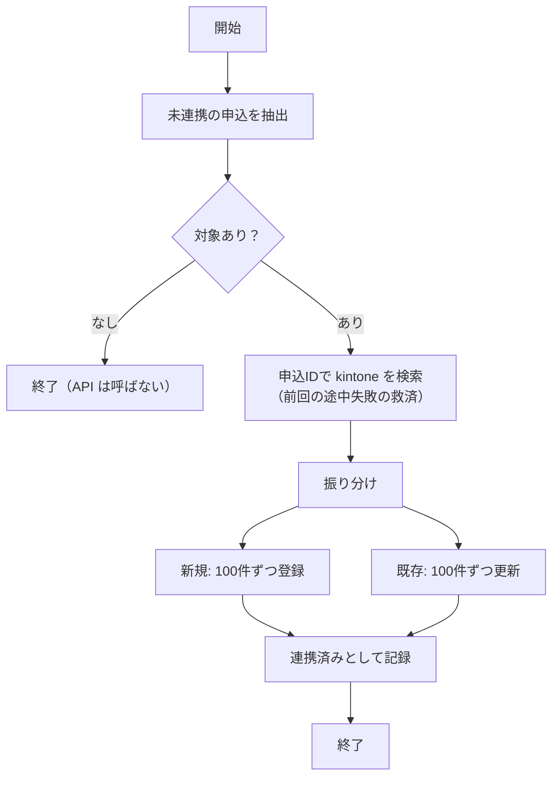
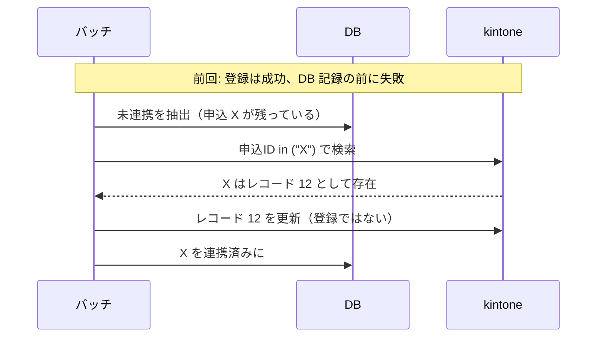

# バッチ設計書（kintone 同期）

| 版 | 日付 | 内容 |
|---|---|---|
| 0.1 | 2026-10-28 | 初版 |

実装: `backend/batch/sync_to_kintone.py`、`backend/batch/kintone_client.py`
テスト: `backend/tests/test_batch.py`

---

## 1. 概要

| 項目 | 内容 |
|---|---|
| 目的 | 本人確認の結果が出た申込を kintone に登録・更新し、審査担当が確認できるようにする |
| 起動 | `python -m batch.sync_to_kintone`（`--dry-run` で対象件数だけ表示） |
| 実行間隔（想定） | 5分ごと |
| 本番の実行基盤（想定） | Cloud Scheduler から Cloud Run Jobs を起動 |
| 終了コード | 0: 正常、1: 失敗（ジョブ失敗として検知・通知する） |

---

## 2. 処理フロー



---

## 3. 抽出条件

```sql
SELECT ...
FROM applications a
LEFT JOIN ekyc_results r ON r.id = (SELECT MAX(id) FROM ekyc_results WHERE application_id = a.id)
WHERE a.status IN ('VERIFIED', 'NEEDS_REVIEW', 'REJECTED', 'EKYC_FAILED')
  AND (a.kintone_synced_at IS NULL OR a.updated_at > a.kintone_synced_at)
```

- 本人確認の結果が出たものだけ（申込直後や本人確認中は送らない）
- 未連携、または連携後に状態が変わったもの
- 結果は最新の1件を使う

---

## 4. 二重登録の防止

**問題:** kintone への登録は成功したのに、DB に「連携済み」と記録する前に落ちると、次回また登録して kintone に同じ申込が2件できる。

**対策:**

1. 登録の前に、対象の申込IDで kintone を検索する
2. 見つかったものは「登録」ではなく「更新」に回す
3. kintone 側の「申込ID」フィールドを **値の重複を禁止する** 設定にし、万一の二重登録をエラーで止める



テスト: `test_recovers_from_previous_partial_failure`

---

## 5. kintone API の制限への対応

| 制限 | 値 | 対応 |
|---|---|---|
| 一括登録・更新の件数 | 1回100件まで | 100件ずつに分割 |
| 一括取得の件数 | 1回500件まで | 検索は100件ずつ（クエリが長くなりすぎないため） |
| 同時リクエスト数 | 1ドメイン100件まで | バッチは1本ずつ順番に実行 |
| 1日のリクエスト数 | アプリごとに上限（スタンダード1万、ワイド10万） | 下の見積もりを参照 |

### 5.1 リクエスト数の見積もり

5分ごと（1日288回）に実行し、1回あたりの対象が100件以下の場合:

| 処理 | 1回あたり | 1日あたり（最大） |
|---|---|---|
| 検索 | 1 | 288 |
| 登録 | 1 | 288 |
| 更新 | 1 | 288 |
| 合計 | 3 | 864 |

対象がない回は API を呼ばないため、実際はもっと少なくなる。スタンダードの1万件に対して十分な余裕がある。

---

## 6. リトライ

| 失敗の種類 | 対応 |
|---|---|
| 通信エラー、429、5xx | 1秒、2秒と待って最大3回まで再試行 |
| 4xx（認証エラー、入力不正、重複など） | 再試行しない。終了コード1で終了 |
| 3回とも失敗 | 終了コード1。DB は未連携のまま残るので、次回の実行で再送される |

テスト: `test_retries_temporary_failure`、`test_gives_up_after_max_attempts`

---

## 7. 送る項目

[データ設計書 5章](04_データ設計書.md#5-kintone-アプリのフィールド想定) を参照。カードの読み取り値は送らない。

---

## 8. 運用

| 事象 | 確認すること | 対応 |
|---|---|---|
| ジョブが失敗した | ログのエラー（kintone のステータスとエラーコード） | 一時障害なら次回の実行で回復。認証エラーなら API トークンを確認 |
| kintone に反映されない申込がある | `kintone_synced_at` と `updated_at` | `--dry-run` で対象に入っているか確認 |
| 二重登録エラーが出た | 申込IDの重複 | 通常は起きない。起きた場合は kintone の該当レコードを確認 |

### 8.1 ローカルで挙動を確かめる

```bash
# モック kintone が最初の2回だけ 503 を返す設定でサーバーを起動
MOCK_KINTONE_FAIL_FIRST_N=2 uvicorn app.main:app --port 8000

# 別のターミナルでバッチを実行すると、リトライの様子がログに出る
python -m batch.sync_to_kintone
```
